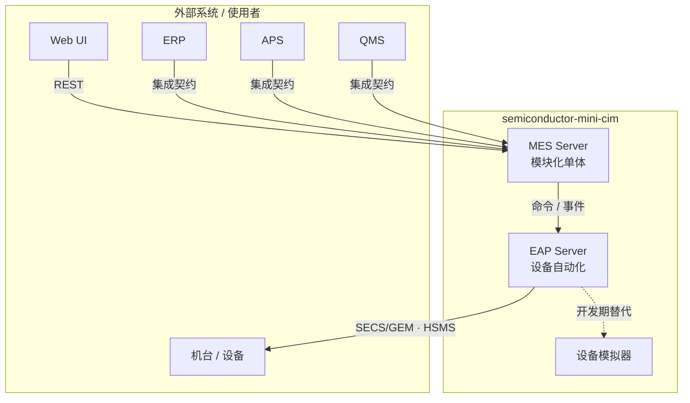
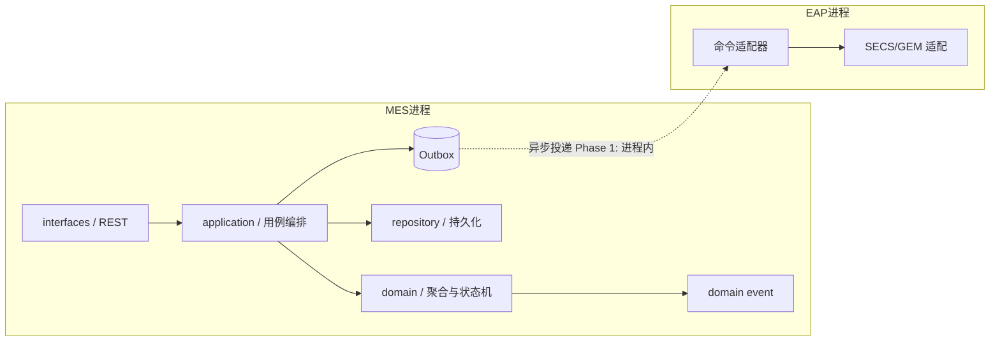
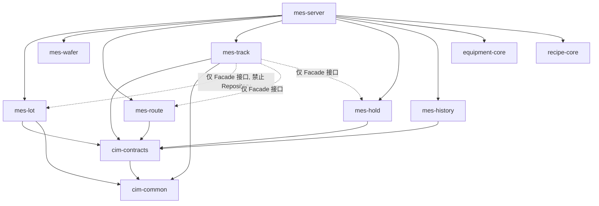
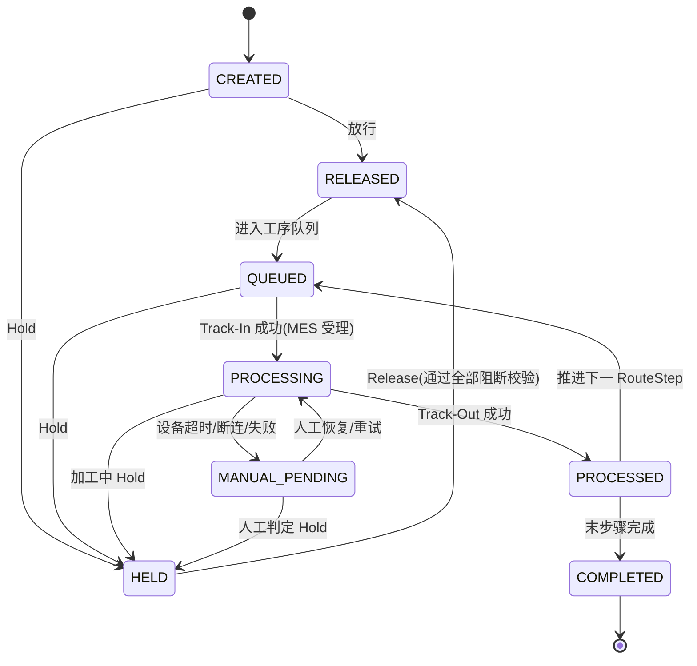
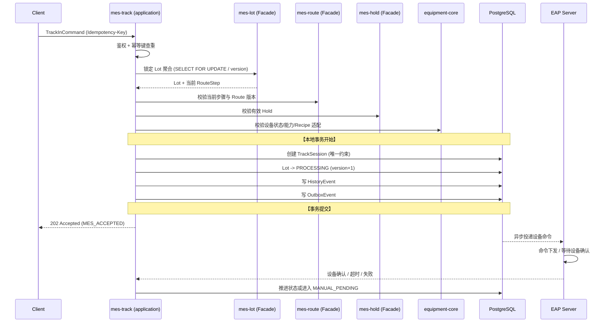

# semiconductor-mini-cim 系统设计（Phase 1）

> 状态：设计草案（Draft）
> 上位文档：`README.txt`《Java 晶圆厂 Mini-CIM 系统：Maven 多 Module 架构规划》
> 本文定位：把 README 中的架构规划细化为可落地的第一版设计，是后续 ADR、数据库设计、接口规范、压测与故障恢复报告的共同基线。

---

## 1. 范围与不做的事

**本文覆盖 Phase 1（MVP）**：一个 Java 进程内的模块化单体，能够把一个 Lot 从创建走完多道工序，并留下完整、可审计的生产履历。

**明确不做（避免范围蔓延）**：

- 不拆微服务，不引入服务注册/发现与分布式事务。
- 不引入 Kafka（可靠事件属于 Phase 3）。
- 不实现真实 SECS/GEM / HSMS 协议栈，设备侧先用模拟器（Phase 2）。
- 不实现 ERP / APS / QMS 真实对接，仅保留集成边界与契约。
- 不追求吞吐量指标，业务正确性与状态一致性优先。

---

## 2. 设计目标与原则

| 目标 | 可验证方式 |
| --- | --- |
| 可运行 | 一条命令启动 MES + 模拟器，跑通端到端生产流程 |
| 可压测 | Track-In/Out 有稳定 P99 基线，压测口径可复现 |
| 可故障注入 | 进程崩溃、设备断连、重复消息、DB 不可用场景可重放 |
| 可演进 | 模块边界清晰，后续拆服务/EAP 独立部署不改领域代码 |

**四条架构原则（来自 README，作为设计裁决依据）**：

1. 领域边界先于微服务边界。
2. 业务正确性先于吞吐量。
3. 设备协议与生产执行解耦。
4. 生产履历必须可审计、可追溯。

**关键决策 D1：第一阶段采用模块化单体。** 所有 MES 领域模块运行在同一个 Spring Boot 进程中，使 Lot 状态变更、TrackSession 创建与 History/Outbox 写入处于同一本地事务；EAP 作为独立进程，通过命令/事件契约交互。理由：Track-In 的强一致要求无法用最终一致替代，而拆分服务会先把复杂度引向分布式事务，违背原则 2。

---

## 3. 总体架构

### 3.1 系统上下文

### 3.2 进程与分层边界

分层规则：

- `interfaces/rest` 只做协议转换与鉴权上下文注入，不含业务规则。
- `application` 是用例编排与事务边界所在层，**是唯一允许开启 `@Transactional` 的层**。
- `domain` 不依赖 Spring、不依赖持久化实现，状态转移必须由聚合自身守卫。
- `api`（Facade + DTO）是模块对外唯一出口；`interfaces/rest` 是对外 HTTP 出口，两者必须分开。

---

## 4. 模块划分与依赖规则

### 4.1 Phase 1 模块清单

沿用 README 第十一节的收敛结论，首版只在根层建 15 个模块，不建二级聚合目录：

| 模块 | 类型 | 职责 |
| --- | --- | --- |
| `cim-common` | 基础 | 公共类型、异常、时间/ID、通用工具 |
| `cim-contracts` | 契约 | 跨模块 Facade 接口、DTO、集成事件定义 |
| `mes-lot` | 领域 | Lot 创建/拆批/合批/状态 |
| `mes-wafer` | 领域 | Wafer ID、Slot、归属、状态 |
| `mes-route` | 领域 | 工艺路线、步骤、版本 |
| `mes-track` | 领域 | Track-In/Out 编排、TrackSession |
| `mes-hold` | 领域 | Hold / Release、原因码、审批 |
| `mes-history` | 领域 | 不可变生产履历与查询投影 |
| `equipment-core` | 领域 | 设备、腔体、端口、能力 |
| `eap-core` | 领域 | 设备命令、会话、消息分发 |
| `eap-simulator` | 基础设施 | 可配置设备行为模拟器 |
| `recipe-core` | 领域 | Recipe 元数据、版本、校验 |
| `mes-server` | 应用 | Composition Root，Spring Boot 装配 |
| `eap-server` | 应用 | EAP 独立进程启动入口 |
| `integration-tests` | 测试 | 端到端 / 契约 / 一致性测试 |

> `cim-bom` 仅做依赖版本管理，不属于运行时依赖链，Phase 1 先用根 POM 的 `dependencyManagement`，不单独建模块。

### 4.2 依赖规则（强制）

1. `cim-common` 不依赖任何业务模块。
2. `cim-contracts` 不依赖任何业务实现，只放接口 / DTO / 事件。
3. 领域模块只依赖 `cim-common`、`cim-contracts` 及明确公开的 `api` Facade。
4. `mes-track` 通过 `cim-contracts` 中的 `LotFacade` / `RouteFacade` / `HoldFacade` 访问其他模块，**不得访问其 Repository 或 domain 实现类**。
5. Track-In/Out 由 `mes-track` 统一编排，任何模块不得绕过它直接更新 Lot 的当前工序。
6. `mes-server` 是唯一 Composition Root，负责 Bean 装配与模块启用。
7. EAP 与 MES 通过命令/事件契约交互，**不共享数据库表**。
8. 建议用 Maven Enforcer / ArchUnit 在构建期校验 1–5 条，防止依赖腐化。

---

## 5. 领域模型

### 5.1 聚合边界与不变量

| 聚合根 | 内部实体 / 值对象 | 核心不变量 |
| --- | --- | --- |
| `Lot` | `LotId`, `LotStatus`, `LotGenealogy`, Wafer 引用集合 | 状态只能按状态机转移；`version` 乐观锁；拆/合批必须生成谱系 |
| `Wafer` | `WaferId`, `Slot`, `WaferPosition` | 同一时刻只能归属一个活动 Lot |
| `Route` | `RouteVersion`, `RouteStep` | 发布后不可修改，只能通过新版本演进 |
| `TrackSession` | `Operation`, 设备/Recipe 快照 | 一个 Lot 同时最多一个活动会话 |
| `HoldRecord` | 原因码、作用范围、操作人、审批 | Release 必须校验全部有效阻断条件 |
| `HistoryEvent` | — | append-only，不可更新、不可删除 |

**跨聚合引用一律用 ID，不用对象引用**；聚合间一致性由 application 层编排，不靠数据库外键级联。

### 5.2 Lot 状态机

所有转移由 `Lot` 聚合方法守卫，非法转移抛领域异常，不允许 application 层直接 `setStatus`。

### 5.3 关键业务规则（实现 checklist）

- Lot 可包含多个 Wafer；Wafer 不能同时归属多个活动 Lot。
- Route 发布后不可直接修改，通过版本演进。
- Track-In 必须验证：Lot 状态、当前 RouteStep、设备能力、Recipe 适配、Hold 状态、幂等键。
- Track-Out 必须匹配有效 TrackSession，校验完成条件并推进工艺步骤。
- Hold 记录作用范围（Lot / Wafer / Equipment）、原因、操作人；Release 检查全部有效阻断条件。
- 所有关键状态变更生成不可变履历事件。

---

## 6. 核心流程：Track-In / Track-Out

### 6.1 Track-In 时序

**事务边界铁律**：数据库事务只覆盖「锁定 → 校验 → 建会话 → 改状态 → 写履历 → 写 Outbox」这一段，**绝不能把事务保持到设备通信完成**。真实加工可能持续数分钟至数小时，必须以持久化状态机 + 异步工作流管理。

### 6.2 MES 状态与设备状态必须分离

**MES 的 Track-In 成功 ≠ 设备已开始加工。** 系统必须显式区分以下状态，禁止合并成一个布尔标志：

| 状态 | 含义 | 触发方 |
| --- | --- | --- |
| `MES_ACCEPTED` | MES 已受理并落库 | mes-track |
| `COMMAND_SENT` | 设备命令已投递 EAP | EAP |
| `EQUIPMENT_ACK` | 设备已确认命令 | EAP |
| `PROCESSING_STARTED` | 设备回报实际加工开始 | EAP |
| `PROCESSING_COMPLETED` | 设备回报完成 | EAP |
| `TIMEOUT` / `DISCONNECTED` / `FAILED` | 进入 `MANUAL_PENDING` 待人工处理 | EAP |

### 6.3 Track-Out

1. 校验幂等键与 TrackSession 有效性（活动、归属、步骤匹配）。
2. 校验完成条件：设备完成回报、必要测量结果、Recipe 参数记录。
3. 同一本地事务内：关闭 TrackSession、推进 RouteStep、Lot → PROCESSED、写 History、写 Outbox。
4. 末步骤则 Lot → COMPLETED；否则进入下一 QUEUED。
5. 重复提交返回既有结果，不产生第二次状态推进。

### 6.4 失败与重试

| 场景 | 处理 |
| --- | --- |
| 请求重试 | Idempotency-Key 返回首次结果 |
| 重复投递 | Inbox 去重（Phase 3）/ TrackSession 唯一约束兜底 |
| 设备命令超时 | 状态机进入 `MANUAL_PENDING`，不自动重试加工 |
| 设备断连 | 重连后按会话快照恢复；无法恢复则明确标记待人工 |
| 进程崩溃 | 事务已提交部分靠 Outbox 与状态机恢复，未提交部分由客户端幂等重试 |

---

## 7. 数据模型

### 7.1 Schema 划分（PostgreSQL，按业务隔离）

| Schema | 主要表 |
| --- | --- |
| `mes_lot` | `lot`, `lot_genealogy` |
| `mes_wafer` | `wafer`, `wafer_position` |
| `mes_route` | `route`, `route_version`, `route_step` |
| `mes_track` | `track_session`, `track_operation` |
| `mes_hold` | `hold_record`, `release_approval` |
| `mes_history` | `history_event`, `history_projection` |
| `equipment` | `equipment`, `chamber`, `equipment_state` |
| `recipe` | `recipe`, `recipe_version`, `recipe_deployment` |
| `integration` | `outbox_event`, `inbox_message`, `idempotency_record` |

> Schema 是逻辑边界，不是安全边界；Phase 1 共用同一数据库与连接，靠依赖规则保证模块不跨 Schema 写表。

### 7.2 关键机制

| 机制 | 落点 | 目的 |
| --- | --- | --- |
| 乐观锁 `version` | `lot.version` | 避免并发 Track-In 覆盖 |
| 唯一约束 | `track_session (lot_id) WHERE active` | 一个 Lot 最多一个活动会话 |
| 幂等键 | `idempotency_record (key, scope)` 唯一 | 请求重试不重复执行 |
| Outbox | `outbox_event` 与业务变更同事务 | 业务变更与待发布事件原子提交 |
| append-only 履历 | `history_event` 禁 UPDATE/DELETE | 可审计、可追溯 |
| 双时间字段 | `occurred_at` / `recorded_at` | 区分事件实际发生与系统记录时间 |

履历事件至少记录：操作者、设备、工艺步骤、Recipe 版本、发生/记录时间、关联 Lot/Wafer/Session ID、前后状态。

---

## 8. 一致性与并发控制

- **单一写者**：Lot 当前工序只由 `mes-track` 修改。
- **事务内原子写**：状态变更 + History + Outbox 必须同事务提交，禁止「先改状态再补履历」。
- **并发 Track-In**：乐观锁 + 活动会话唯一约束双保险，后者冲突时返回明确业务错误而非 500。
- **状态机守卫**：所有转移在聚合内校验，DB 层再加 `CHECK` 约束兜底。
- **Phase 3 演进**：Outbox → Kafka → Inbox（消费去重、重试、死信、积压监控、一致性对账），领域代码不改。

---

## 9. 设备与 Recipe 集成（Phase 2 边界预留）

- `eap-server` 独立进程，与 MES 只通过 `cim-contracts` 的命令/事件交互，不共享 DB 表。
- `eap-simulator` 先行，支持可配置行为：确认延迟、随机断连、命令失败、重复回报，用于故障注入。
- 真实协议栈分层：`eap-core`（命令/会话/分发）→ `eap-hsms`（连接与帧）→ `eap-secs-gem`（SECS-II/GEM 消息与事件）。
- Recipe：`recipe_version` 版本不可变，下发前校验设备能力 + 当前 RouteStep 适配，审批通过后激活；下发结果写入履历。

---

## 10. REST API 草案

统一请求头：`Idempotency-Key`（写操作必填）、`X-Operator`（审计操作人）。

| 方法 | 路径 | 说明 |
| --- | --- | --- |
| `POST` | `/api/v1/lots` | 创建 Lot |
| `POST` | `/api/v1/lots/{id}/split` | 拆批 |
| `POST` | `/api/v1/lots/{id}/merge` | 合批 |
| `GET` | `/api/v1/lots/{id}` | Lot 详情（含 Wafer 列表） |
| `POST` | `/api/v1/routes` / `POST /{id}/versions` | 路线创建 / 版本演进 |
| `POST` | `/api/v1/track-in` | Track-In（返回 202 + sessionId） |
| `POST` | `/api/v1/track-out` | Track-Out |
| `POST` | `/api/v1/holds` / `POST /{id}/release` | Hold / Release |
| `GET` | `/api/v1/lots/{id}/history` | 履历查询（append-only 投影） |
| `GET` | `/api/v1/equipments/{id}` | 设备状态 |

错误分类：400 参数/状态非法、409 并发或幂等冲突、422 业务规则阻断（Hold/Recipe/能力不匹配）、202 已受理但设备侧未完成、5xx 系统故障。**业务阻断不得伪装成 200**。

---

## 11. 可观测性、压测与故障注入

- OpenTelemetry 全链路追踪，`trace_id` 贯穿 REST → 领域事件 → Outbox → EAP 命令。
- 关键指标：Track-In/Out P99、活动会话数、Outbox 积压、设备命令超时率、履历写入完整性。
- 验收指标（Mini-CIM 实验项目目标值，非任何真实晶圆厂指标）：

| 指标 | 初期目标 |
| --- | --- |
| Track-In / Track-Out API P99 | ≤ 200 ms（不含设备加工） |
| Track-In 重复提交 | 不产生重复有效会话 |
| 生产履历完整性 | 关键已提交状态变更 100% 有履历 |
| Lot 状态一致性 | 不出现非法状态转移 |
| 设备断连恢复 | 可恢复或明确标记待人工处理 |
| 消息重复投递 | 不重复产生业务效果 |
| 压测规模 | 从 1,000 Lot / 25,000 Wafer 起步 |

P99 报告必须声明硬件规格、并发数、数据规模、数据库配置与压测持续时间，否则不可比较。

故障注入清单：进程崩溃、设备断连、网络分区、数据库切换、Kafka 不可用（Phase 3）、重复消息、恢复后履历一致性对账。

---

## 12. 分阶段路线与退出条件

| 阶段 | 内容 | 退出条件 |
| --- | --- | --- |
| 1 MVP | Lot + Wafer + Route + Track + Hold + History，REST、单测、端到端流程 | 可模拟一个 Lot 走完多道工序且履历完整 |
| 2 设备 | Equipment + EAP + Recipe，模拟器、协议适配、断线重连 | 设备断连/超时可恢复或明确待人工 |
| 3 可靠性 | Kafka + Outbox + Inbox + 审计、去重、重试、死信 | 重复投递不产生重复业务效果 |
| 4 工业化 | Kubernetes + 压测 + 混沌测试 | 验收指标达标且故障恢复报告完整 |

---

## 13. 待决事项（后续以 ADR 记录到 `docs/adr/`）

- **ADR-001** 模块化单体 → 微服务的拆分判据与触发条件。
- **ADR-002** 乐观锁 vs 悲观锁在并发 Track-In 下的取舍与压测依据。
- **ADR-003** Outbox 投递方式：进程内轮询 vs CDC（Debezium）。
- **ADR-004** 履历存储：单表 append-only vs 按时间分区 / 归档策略。
- **ADR-005** 设备状态机与 MES 状态机的映射及对账机制。
- **ADR-006** 幂等键作用域与过期清理策略。
- **ADR-007** 模块边界的自动化校验（Enforcer / ArchUnit）落地方式。
- **ADR-008** 多租户 / 工厂（Fab）维度是否在 Phase 1 引入。

---

## 附录：相对 README.txt 的收敛点

1. 首版采用 README 第十一节的 15 模块扁平结构，不建 `cim-mes/` 等二级聚合目录。
2. `cim-bom` 暂不独立建模块，依赖版本先集中在根 POM。
3. 明确了 `application` 层是唯一事务边界，以及 `api` Facade 与 `interfaces/rest` 的分离约束。
4. 把「MES 受理」与「设备实际加工」展开为显式状态表，避免实现时合并。
5. 补充了 Lot / TrackSession 状态机、幂等与 Outbox 的落库约束、REST 草案与 ADR 待决项。
